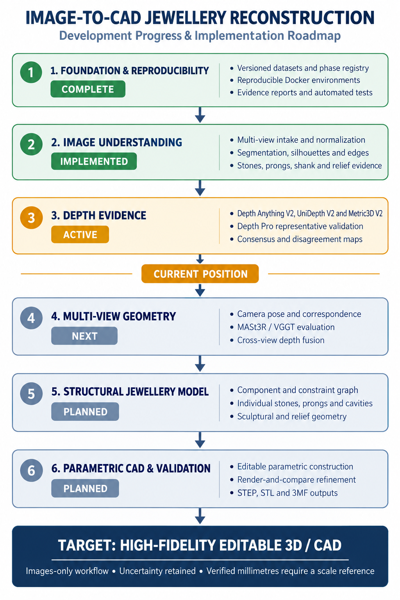

# Image-to-CAD jewellery reconstruction roadmap

Status snapshot: 18 October 2026.

This visual summarizes the active **images-only** execution profile. It does not
replace or renumber the canonical [Project Bible roadmap](../bible_v1_0/19_DEVELOPMENT_ROADMAP.md).

## Current position

- Reproducibility, dataset organization and automated validation are established.
- Image intake, segmentation, silhouettes, edges and component evidence are implemented.
- Four metric-depth models have been evaluated; three cover all 20 selected views and Depth Pro covers four representative front views.
- Same-view consensus and disagreement maps are available.
- Metric3D direct surface normals and three-model depth-derived normal proxies
  are retained for 20 selected views, with angular disagreement maps.
- Cross-view camera and geometry alignment through VGGT is now under active
  validation; its outputs remain non-metric machine hypotheses.
- The public-deployment audit leaves VGGT with its gated commercial checkpoint
  as the only eligible learned cross-view candidate; no backend is product-ready.
- A noncommercial Ring01 VGGT run completed locally at 224 px on the 4 GiB GPU,
  but its fused point cloud failed visual review because of ghosting and outliers.
- Three more STL-1 rings now have dense VGGT runs: one training object and two
  test objects. All ran below 4 GiB. Their original 224 px point-map
  leave-one-surface-out scores were `0.106–0.158` mean IoU; the target point
  map is excluded, but VGGT cameras are still jointly inferred from all views.
- External real-image coverage includes 206 images for Phase 1/2. These images
  cannot be used as multi-view geometry evidence without verified same-object
  identities and view semantics.
- Object-centric reframing was tested on the same three VGGT objects and
  rejected: cohort mean leave-one-view-out IoU decreased from `0.140` to
  `0.126`. The failed refinement and comparison preview are retained.
- VGGT's pairwise optical-axis relationships are within `7.745` degrees of the
  named-view priors on average, but the semantic holdout minimum is only
  `0.274`. Naive semantic camera snapping reduced mean completion IoU to
  `0.068`, so the original learned cameras remain the baseline.
- A `224–518` px VGGT resolution ladder was evaluated. The selected 518 px
  setting was chosen on three validation rings (`0.428` to `0.482` mean IoU)
  and raises test-ring mean completion IoU from `0.132` to `0.492`,
  precision from `0.468` to `0.844`, and recall from `0.155` to `0.541` while
  remaining below 3.13 GiB peak CUDA allocation.
- Sequential 518 px execution now releases inference tensors between objects;
  all three representative rings complete in one process. A train-learned
  source-view policy was rejected because its small precision gain reduced
  held-out IoU and recall.
- Camera-space visual-hull completion now intersects the four non-target
  silhouettes. Validation mean IoU is `0.737`; full three-object test mean IoU
  is `0.738`, a `+0.272` gain over the selected point-map baseline. The minimum
  test view is still only `0.415`, and inspection confirms that the hull fills silhouettes
  without reconstructing relief, holes, cavities or component topology.
- A validation-selected surface shell now combines that hull with VGGT source
  points. At the selected `4%` robust-diagonal distance, validation mean/minimum
  IoU reaches `0.757 / 0.566` and the complete three-object test result reaches
  `0.757 / 0.504`. Test mean gains `+0.019` over the plain visual hull and
  `+0.292` over the point-map baseline, but inferred openings remain uncertain.
- Signed-depth free-space carving now rejects voxels that lie clearly in front
  of source-view VGGT surfaces. The validation-selected setting reaches
  `0.781 / 0.578` mean/minimum IoU. Fixed evaluation on all three test rings
  reaches `0.782 / 0.529`, improving mean IoU by `+0.024` over the surface-aware
  hull and `+0.316` over the point-map baseline. Every test object improves,
  but the minimum remains below the geometry gate and topology is unvalidated.
- Source-view normal-consistency carving was tested using finite-difference
  normals from VGGT world-point maps. Validation selected a zero cosine
  threshold, so no normal-based deletion was accepted. The experiment is
  rejected until an independent, better-aligned normal estimator is available.
- Structural negative-space margins were tested on large enclosed source-mask
  regions. A validation-selected 4 px margin raised the weakest held-out IoU
  from `0.529` to `0.542`, but reduced held-out mean IoU from `0.782` to
  `0.777`. It is retained as aperture evidence, not as the default geometry.
- Bounded source-camera image-plane alignment was tested with translation and
  isotropic scale searches fitted from source views only. Although those fits
  improved source reprojection by up to `0.048` IoU, every non-identity profile
  reduced pooled validation reconstruction IoU. Validation selected the
  original VGGT cameras, and the experiment was rejected without changing the
  signed-depth baseline.
- Physically consistent rigid source registration was then tested by applying
  each bounded SE(3) transform to a source point map and its camera together.
  ICP lowered source-cloud distance, but even the tiny bound reduced validation
  mean IoU from `0.780605` to `0.779059`; the medium bound fell to `0.768162`.
  Repeated and symmetric jewellery surfaces make unconstrained nearest-neighbour
  matches unreliable, so validation again retained the original geometry.
- The pinned VGGT track head then produced 96 sparse queries per view for seven
  rings while staying below 4 GiB of GPU memory. Bounds and source-query
  integrity checks passed, but they do not prove physical correspondence.
  Track-guided rigid fitting selected the strict profile after a `+0.000444`
  validation mean-IoU gain, then lost `-0.002421` on the fixed test split.
  Visual review found long-baseline matches collapsing onto repeated ornament,
  so this experiment is rejected and signed-depth carving remains active.
- A denser follow-up produced 384 queries per view for the same seven-ring
  cohort while remaining at `2.44 GiB` peak CUDA allocation. Reciprocal
  A-to-B-to-A filtering removed many ambiguous tracks, but every non-identity
  registration profile reduced validation IoU. Validation therefore selected
  identity before test scoring; test IoU remains the signed-depth baseline at
  `0.781514 / 0.529146`. Dense tracks are retained only as unreviewed evidence
  for future component relationships, not as geometry correction.
- Projection-noise analysis found that more than `99.9%` of retained voxels
  belong to the largest 3D component on average; the visible scan-line gaps are
  primarily coarse voxel-to-pixel rasterisation artifacts. Validation selected
  a `3×3` close only for raw projections with at least four foreground
  components. The frozen renderer raises test mean IoU from `0.781514` to
  `0.788982`, improves every test object, regresses no test view and leaves the
  weakest IoU unchanged at `0.529146`. It is retained for cleaner review only;
  the voxel geometry and geometry-gate decision are unchanged.

## Remaining implementation

Phase 4 now has a deterministic component-graph API and a Ring01 machine
proposal with stable IDs, provenance, uncertainty and explicit
stone-to-seat/cavity/prong dependencies. A synthetic ten-stone graph passes all
30 remove/resize/replace locality cases without changing unrelated node state.
Those operations now also pass a retained exact-CAD benchmark: 71 independent
CadQuery/OCP source components are regenerated in every case, every unrelated
B-rep remains byte-identical, and all 30 derived metal bodies remain valid
single solids. Baseline and Stone 007 edit assemblies are exported as STEP/STL.
Ring01 now also has four disjoint machine-proposed prong masks in front, top and
angled views; side and back remain honest two-member overlap groups. This is
still synthetic CAD truth plus unreviewed image evidence. Retained VGGT point maps
independently select the same front-to-top and front-to-angled ID assignment;
top support is strong while angled support is moderate. Ring01 still has zero
approved graph nodes, so no image-derived exact CAD is authorized.
The Phase 4 exit gate therefore remains blocked.

Phase 5 has now started independently of that blocked image-review gate. Four
designed structural fixtures—round solitaire, oval solitaire, three-stone and
halo—pass exact B-rep validity, one-metal-solid topology, independent STEP
reload and watertight derived-mesh checks. This validates the reusable CAD
generator foundation only. It does not show that images can yet select or fit
those parameters accurately.

The first dataset bridge now keeps the scope ring-only and processes all 24
STL-1 objects and 120 views. It proposes scale-normalized inner-aperture and
shank measurements while preserving the fixed 18/3/3 split. The retained audit
shows the detected aperture and robust radial samples for every ring. These are
image measurements for initializing fitting, not physical millimetres or
accepted CAD.

Phase 5.1 now converts those observations into exact periodic-spline shank
B-reps and exports one STEP body for every STL-1 ring. The 18 training objects
reach `0.932061` mean top-view shank IoU and the three validation objects reach
`0.935501`; boundary F1 is `0.987267` and `0.984843`. The three test rings are
retained but unscored. These are same-silhouette fitting-consistency metrics,
not independent geometry truth, and no head/detail or physical-scale claim is
made.

Phase 5.2 now adds a connected two-view head-support envelope to every shank.
The retained implementation intersects the front ornament silhouette with the
top head profile instead of using the rejected rectangular envelope. Validation
front/top IoU is `0.973288`/`0.983941`; all 24 head solids, all 48 shoulders and
all fused metal bodies are valid, connected B-reps with STEP exports. Actual
tessellated CAD previews for rings 004, 012 and 020 were inspected separately.
That Phase 5.2 checkpoint approves the structural outer envelope only. Relief,
faces, stones, prongs, seats, cavities and physical millimetres remain
unimplemented; openwork advances separately as the candidate trial below.

Phase 5.3 now reuses the 168 stable front-view negative-space IDs from Phase 4
and trials each one as an exact Boolean cut. All trial cuts preserve valid,
connected head and fused-metal B-reps across the 24 rings. Validation front IoU
improves from `0.973288` to `0.987284`, with `0.969656` boundary F1; the test
split remains unscored. This is a candidate-geometry checkpoint only. It does
not resolve whether an opening is decorative openwork, a bezel interior, a
missing insert or a segmentation error, and it does not infer hidden cut depth.

Phase 5.4 now measures sculptural-relief evidence across all 24 rings and all
120 views without embossing raw brightness. It combines repeat-validated
relative depth, image-detail support, uncertainty and the retained three-model
metric-depth supplement where available. It emits 24 separate front-view OBJ
evidence surfaces plus confidence, signed-relief and rejected-detail maps. The
validation split supports only `0.076056` of thresholded fine detail on average,
while `0.238673` remains explicitly unresolved. The actual validation OBJ
previews are shallow open surfaces, which correctly exposes that current depth
models do not recover deity faces and carving at the required fidelity. These
objects are not fused into the exact STEP body and make no relief-accuracy,
metric-scale or manufacturing claim.

Phase 5.5 now evaluates that relief evidence against the retained 384-query
VGGT tracks for a fixed seven-ring cohort. A source point survives only when a
second view also contains depth-supported detail, forward and reverse tracks
pass visibility/confidence thresholds, nearest-query association is bounded,
and the reciprocal cycle closes within 16 pixels. The common gate is identical
for every ring; the 15-view Metric3D normal supplement is reported separately
so rings without normals are not given an easier hidden rule. Validation keeps
178 of 623 front candidates (`0.285714`). Ring 004 keeps only six, all through
the isometric view, while top views support none across the cohort. This is
sparse review evidence, not dense physical correspondence or CAD authorization.

Phase 5.6 expands the retained 384-query VGGT evidence to all 24 STL-1 rings
and applies the unchanged Phase 5.5 thresholds. All extraction checks pass at a
2.62 GB peak CUDA allocation. Training retains 1,420 of 4,610 front candidates
(`0.308026`); validation remains 178 of 623 (`0.285714`). The three test rings
have review artifacts but remain outside every aggregate. The broad per-ring
spread and absent top-view support still block dense correspondence and CAD
relief fusion.

Phase 5.7 introduces a no-regression hybrid density policy: all 384 baseline
queries and decisions remain exact, while 640 unique relief-focused queries are
appended. Across all 18 training rings, mean reciprocally supported-area
coverage increases by `0.159578`; the frozen policy then increases it by
`0.156563` across all three validation rings, with every ring improving. The
three test rings remain untouched. Visual review confirms denser coherent
front/isometric evidence, but top-view support is still nearly absent. This is
an evidence-coverage gain, not dense physical correspondence or CAD approval.

Phase 5.8 adds complete three-model depth and normal evidence for all 15 fixed
validation views. Metric3D direct normals are checked against a comparator made
only from Depth Anything V2 and UniDepth, excluding Metric3D depth. The audit
reproduces all 736 Phase 5.7 supported points, corroborates 521 (`0.707880`) and
leaves 215 unresolved. Only one front-to-top track exists across the cohort.
The result is retained as uncertainty annotation because there is no normal
ground truth, calibrated cross-view rotation or physical geometry truth.

Phase 5.9 converts those frozen validation observations into a visibility-aware
graph. Every candidate front query has a stable ID; every accepted edge records
its actual target view, reciprocal-cycle evidence, score and normal status.
Nearby supported queries are grouped only when they share an observable target.
The graph reproduces all 736 supported and 521 normal-corroborated points, but
only 45 supported queries have normal-corroborated evidence from two or more
target views. This prevents invisible surfaces from being forced into unrelated
views. The graph is a routing and review layer, not physical visibility truth,
semantic segmentation, hidden-geometry recovery or CAD authorization.

Phase 5.10 attaches the 30 validation visibility regions to stable machine
component proposals. Every relief proposal has an exact metal/head parent,
visibility provenance, a deterministic image-space zone and optional proximity
links to the existing unresolved negative-space candidates. Three regions have
multi-view normal support, 22 have single-view support and five remain
normal-unresolved. Four regions lie near negative-space evidence. These links
organize later review; the unlabelled STL-1 images do not prove stones, prongs,
faces, seats or cavities, so semantic and CAD-fusion gates remain closed.

Phase 5.11 subdivides broad Phase 5.10 proposals using four independent routing
signals: image-space proximity, a shared reciprocal target view, continuity in
repeat-regularized relative depth and prepared-edge barriers. A deterministic
maximum-diameter split prevents transitive point chains from recreating a single
large region. The 30 parents become 83 bounded patches while every supported
source query is retained exactly once. Forty patches have at least three queries
and normal support for future fitting review; 28 singleton observations remain
explicitly unresolved. Visual review rejected an earlier 227-patch configuration
as noisy before retaining this bounded result. The patches are not semantic
components, physical surfaces or CAD geometry.

Phase 5.12 performs the first deliberately reversible local surface trial. It
triangulates only the 40 Phase 5.11 patches that have at least three queries and
normal-supported reciprocal evidence. All 40 produce finite open OBJ groups:
676 vertices and 1,018 faces across Ring 004, Ring 012 and Ring 020. Their mean
same-view interpolation RMSE is `0.278` against the retained normalized relief
evidence. Ring 004 is weakest at `0.392`, so no geometry is promoted. The error
is not physical ground truth because the vertices and validation target come
from the same retained image-depth evidence. Test remains untouched, no STEP is
written and exact CAD is unchanged.

Phase 5.13 tests the unchanged Phase 5.12 surfaces outside the front view that
created them. Existing triangle connectivity is projected through retained
normal-corroborated reciprocal tracks, then source-derived relief is compared
with separately prepared target-view relief without target refitting. Only 5 of
56 target evaluations pass. Five patches have single-target review support, no
patch has support from two targets, 26 are target-inconsistent and nine cannot
form a target triangle. The cohort audit was visually inspected and the
projections land on the expected target ornaments. This retained negative
result blocks surface promotion; it does not trigger threshold relaxation.

Phase 5.14 freezes the Phase 5.13 surfaces, scores and thresholds, then
attributes each failure. The most common primary blockers are insufficient
normal-supported tracks (`12`) and no improvement over flat relief (`12`),
followed by orientation instability (`8`) and excessive target relief RMSE
(`8`). The patch action queue sends 24 patches to cross-view topology research
on the training split, 11 to view-invariant relief research and five to a
second-target search. This diagnosis does not improve the gate by itself and
does not authorize any surface or CAD operation.

Phase 5.15 implements the structural action on training data only. Bounded
local triangles require three reciprocal vertices in the same target view and
must remain non-degenerate and orientation-preserving after projection. The
hybrid query policy raises the retained count from `2,252` to `6,913`; all 18
training rings improve and none regresses. The result is still incomplete:
front-to-top topology appears on only two training rings. The policy is frozen
for one validation evaluation, while the Phase 5.13 scores and surfaces remain
unchanged.

1. Evaluate the frozen Phase 5.15 local-topology settings once on the three
   validation rings, without threshold or parameter changes. Keep the test
   split untouched and report weak target routes explicitly.
2. Continue the Phase 5.14 appearance/depth action on training rings by
   developing a view-invariant relief representation for the 11
   appearance/depth-blocked patches.
3. Review or label the Phase 5.12 surface groups and the Phase 5.11 patches,
   then merge or split only with additional
   evidence where a patch still crosses ornaments. Image-plane fitting, rigid
   ICP, sparse VGGT tracks and denser reciprocal-cycle registration have all
   been rejected for global geometry movement by the fixed held-out split.
4. Use pairwise camera-angle diagnostics, projected-surface precision and
   completion recall separately instead of treating IoU as camera accuracy.
5. Improve the current signed-depth minimum from `0.529` to at least `0.700`
   while raising mean IoU from `0.782` to at least `0.800`; the current method
   still fails the geometry gate.
6. Improve fine-detail geometry beyond the Phase 5.4 depth-supported baseline,
   add independent normal corroboration and recover top-view reciprocal support
   before any OBJ evidence is converted into an exact CAD surface.
7. Keep the implemented Depth Anything V2 plus UniDepth normal comparator as a
   deployability-safe uncertainty check; do not substitute DSINE without a
   separate site/commercial licence.
8. Review the 266 enclosed negative-space proposals retained across all 120
   STL-1 views; they are aperture/openwork evidence, not confirmed stones.
9. Add labelled real-image multi-stone evidence and resolve each accepted
   stone across views before creating seat or cavity relationships.
10. Extend the implemented normalized ring adapter to head, shoulder, gallery,
   relief and accepted component-track parameters, including uncertainty.
11. Connect reviewed image observations to the validated independently editable
   stone, prong, seat and cavity generators; add relief generators separately.
12. Add collision, clearance, minimum-wall and manufacturability checks to the
   synthetic exact-CAD benchmark.
12. Generate image-derived parametric CAD and refine it through
    render-and-compare validation.
13. Export editable STEP plus derived STL and 3MF artifacts with explicit
    image-fit and uncertainty reports.

The target is a high-fidelity, structurally editable reconstruction. Under the
images-only constraint, verified millimetres and manufacturing accuracy cannot
be claimed without a scale reference.
